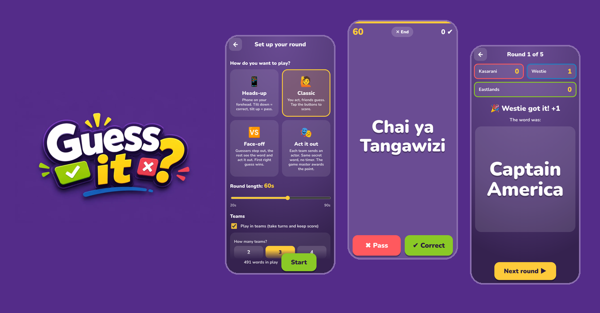
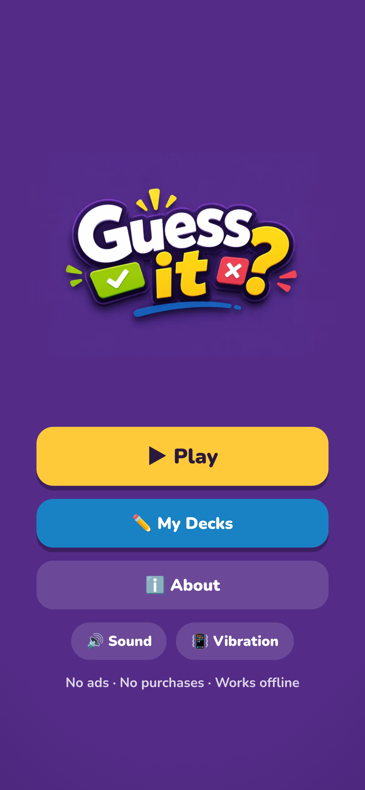
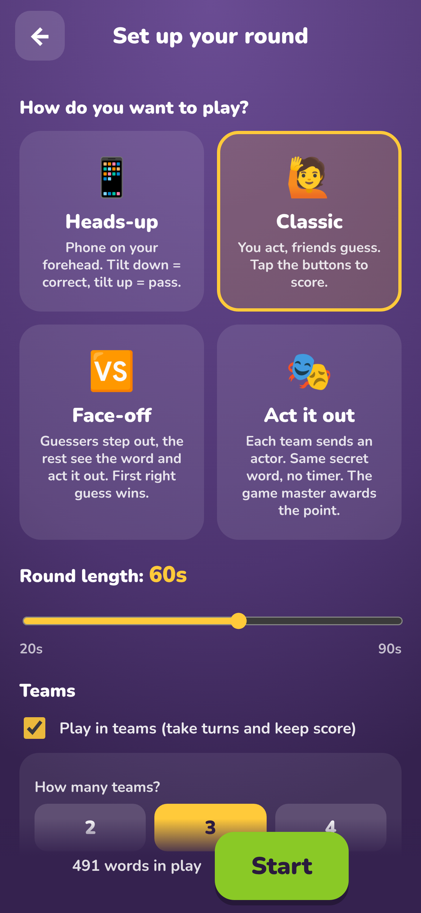
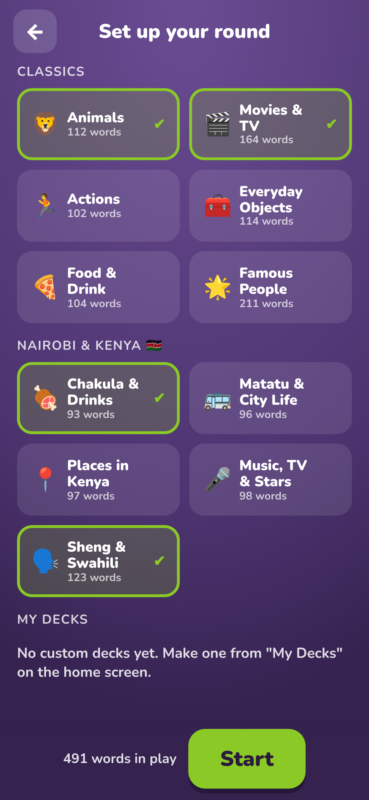
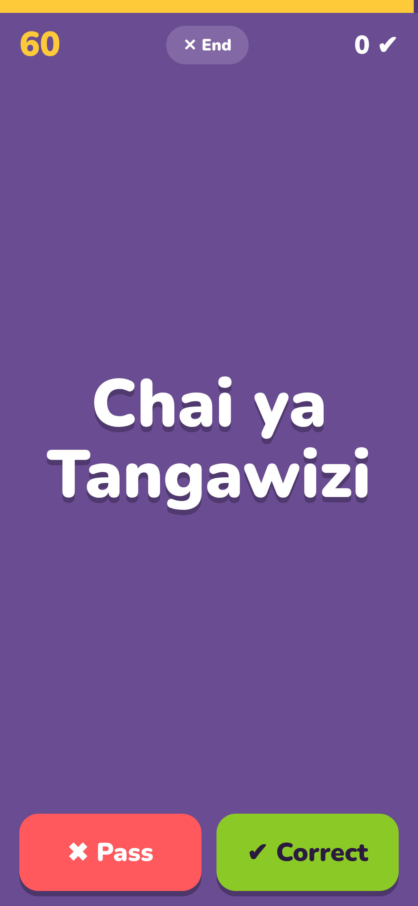
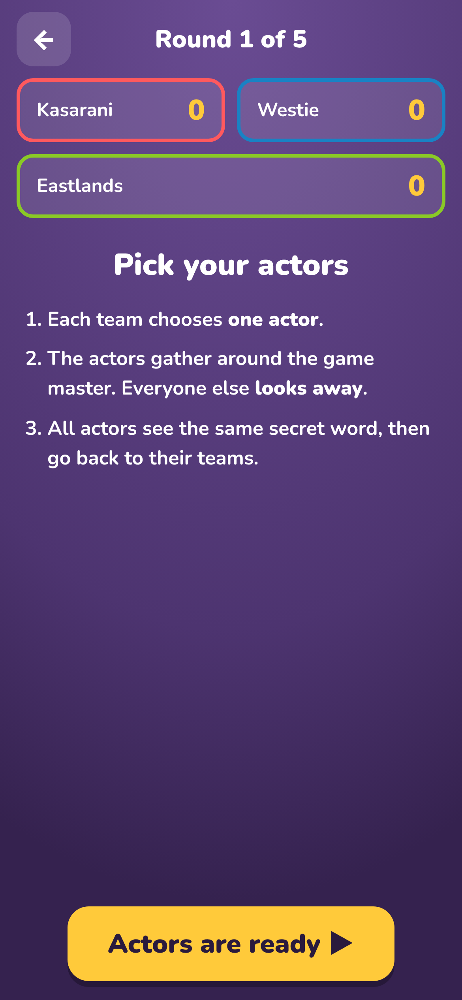
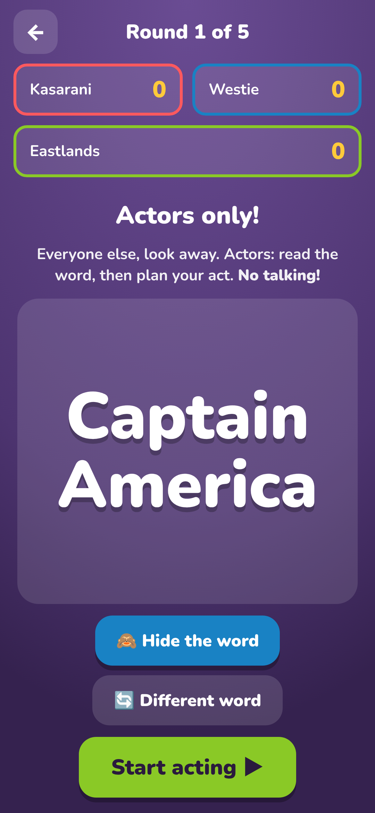
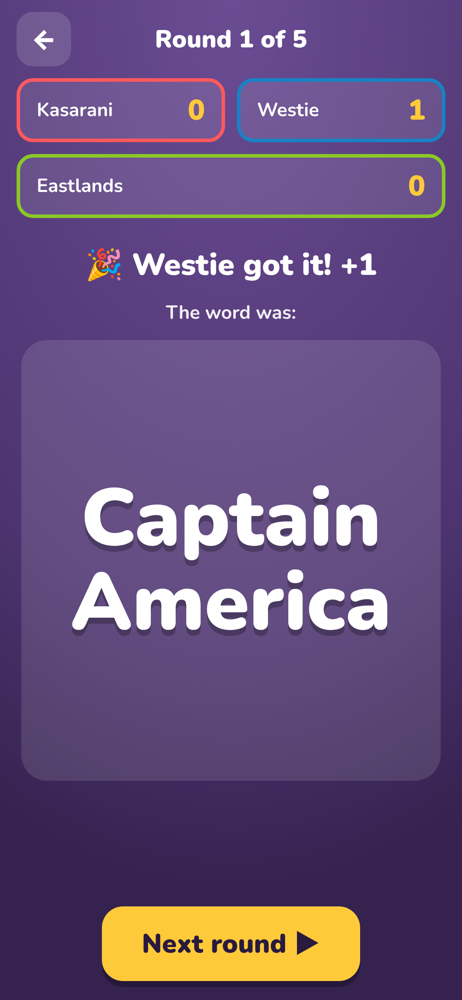
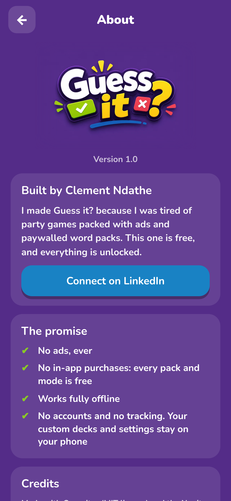
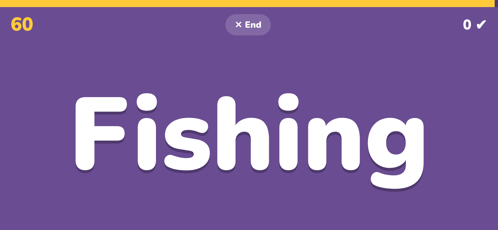

  

# Guess it? 🎉

**A free party game for Android. No ads. No purchases. Every pack unlocked. Works offline.**

I built Guess it? because I was tired of party games packed with ads and paywalled word packs. Here, everything is free.

## ⬇️ Download

**[Download the latest APK](https://github.com/xclemz21/Guess-it-game/releases/latest/download/Guess-it.apk)**
(or see all versions on the [Releases page](https://github.com/xclemz21/Guess-it-game/releases))

### Install in 3 steps
1. Tap the download link above on your Android phone.
2. Open the downloaded **Guess-it.apk**. If Android asks, allow installs from your browser or file manager.
3. If Play Protect says the app is unrecognised, tap **More details → Install anyway**. (This happens because the app isn't on the Play Store yet.)

Updating? Install the new file over the old one. Your custom decks are kept.

## 🎮 Four ways to play

| Mode | How it works |
|---|---|
| 📱 **Heads-up** | Hold the phone on your forehead. Friends act out the word. Tilt **down** when you get it, tilt **up** to pass. |
| 🙋 **Classic** | You see the word and act it out. Friends guess. Tap ✔ Correct or ✖ Pass. |
| 🆚 **Face-off** | Two teams. Each picks a guesser who steps out. The rest see the word, act it out, and the first team to guess wins the point. |
| 🎭 **Act it out** | 2–4 teams. Each team sends an actor who gets the same secret word. No timer. The game master awards the point, or swaps a word that is too hard. |

Plus: **teams with custom names and a scoreboard**, round timer from 20 to 90 seconds, an **End round** button, sounds, vibration and a results summary.

## 📚 1,300+ words in 11 packs
**Classics:** Animals · Movies & TV · Actions · Everyday Objects · Food & Drink · Famous People (leaders, celebrities and athletes)
**Nairobi & Kenya 🇰🇪 (English + Swahili + Sheng):** Chakula & Drinks · Matatu & City Life · Places in Kenya · Music, TV & Stars · Sheng & Swahili

Want your own? Build **custom decks** right in the app.

## 🔒 Privacy
No accounts. No ads. No analytics. No tracking. Your custom decks and settings stay on your phone.

## Screenshots

     

     

## About
Built by **Clement Ndathe** · [LinkedIn](https://www.linkedin.com/in/clement-ndathe-7b8b222a1)

© 2026 Clement Ndathe. All rights reserved. Free to play and to share the link; the app, code, artwork and word packs may not be copied or redistributed.
Open-source credits: Capacitor (MIT) and the Nunito font (SIL Open Font License).
